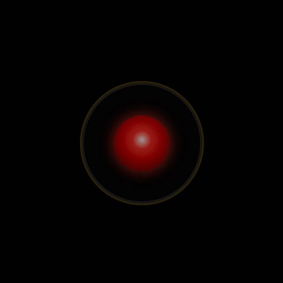

# HAL 9000 eye for Home Assistant

A HAL-9000 eye that reacts to your voice assistant. It can also take over a wall tablet while HAL is talking, then hand the dashboard back exactly as you left it.



## What it does

The eye follows the state of an Assist satellite:

| Satellite state | Eye |
|---|---|
| `idle` | slow breathing glow |
| `listening` | brightens, with a ripple ring |
| `processing` | a red arc spins around the rim |
| `responding` | the lens flickers while HAL speaks |

Anything else, such as `unavailable`, shows the idle eye.

There are two [button-card](https://github.com/custom-cards/button-card) templates:

- **`hal_eye`** is the eye on its own. Put it on a panel view for a dedicated HAL screen.
- **`hal_eye_overlay`** is the same eye as a full-screen takeover. Drop it onto any view. It stays hidden while HAL is idle. When you speak to HAL it covers the whole screen, including HA's header and sidebar, and when HAL goes quiet it disappears.

## Requirements

- [button-card](https://github.com/custom-cards/button-card), installed from HACS. Version 7 or later is recommended; older versions work, but see the note under [Options](#options).
- An Assist satellite, meaning an `assist_satellite.*` entity. Examples are an ESPHome satellite (Atom Echo, Home Assistant Voice PE…) or a Wyoming satellite.

That's all. It needs no other integrations or JavaScript files.

## Install

The templates go under your dashboard's `button_card_templates:` key.

**Dashboards in YAML mode:** copy `hal-eye.yaml` to `config/button_card_templates/hal-eye.yaml`, then add this at the top of the dashboard:

```yaml
button_card_templates: !include_dir_merge_named /config/button_card_templates
```

Use the absolute `/config/...` path. A relative path is resolved from the dashboard file's own folder, which breaks for any dashboard not kept in `config/`.

If you already have a `button_card_templates:` section, paste both templates from `hal-eye.yaml` into it.

**Dashboards edited in the UI:** open the dashboard, then ⋮ → *Edit dashboard* → ⋮ → *Raw configuration editor*. Paste the contents of `hal-eye.yaml` under a top-level `button_card_templates:` key, indented one level.

## Use it

A dedicated HAL screen ([examples/panel-view.yaml](examples/panel-view.yaml)):

```yaml
type: custom:button-card
template: hal_eye
entity: assist_satellite.YOUR_SATELLITE
```

A takeover on an existing dashboard ([examples/overlay.yaml](examples/overlay.yaml)). Add it to every view you want covered. It takes up no space while hidden:

```yaml
type: custom:button-card
template: hal_eye_overlay
entity: assist_satellite.YOUR_SATELLITE
```

## Options

All of these are optional. Set them under `variables:`.

| Variable | Template | Default | Effect |
|---|---|---|---|
| `eye_size` | both | `38vw` | Eye width, as any CSS length (capped at 360px). |
| `speaking_entity` | both | none | While this entity is `on`, the eye speaks even if the satellite is idle. Use it with your own "TTS announcement is playing" flag. On the overlay it also makes the eye show. |
| `active_entity` | overlay | none | Decides when the overlay shows, in place of the satellite state. Use the [linger helper](extras/linger.yaml) so the eye stays up a few seconds after HAL finishes. If the entity doesn't exist, the overlay falls back to the satellite state. |
| `mute_entity` | overlay | none | While this entity is `on`, the overlay never shows, including for announcements. |

> **On button-card 7 or later**, every entity the templates read is tracked automatically, so there's nothing more to do. **On older versions**, also list any entities you set above under `triggers_update:` (see [examples/overlay.yaml](examples/overlay.yaml)), or the card won't redraw when they change.

## How it works

The overlay relies on two simple tricks:

1. **`position: fixed` escapes the dashboard.** A card with fixed positioning and a high `z-index` is placed relative to the browser window, not its column. So it covers HA's header and sidebar, not just its own slot.
2. **A `display` toggle instead of navigation.** When HAL is idle the card is `display: none`, so it takes no space and doesn't block taps. The dashboard underneath is never unloaded or navigated away from. When the eye disappears, the view keeps its scroll position and any open state, exactly as you left it.

## Make it actually HAL

[extras/](extras/README.md) has a linger helper, a few film-line intents ("open the pod bay doors"), and tips for choosing a voice.

## Troubleshooting

- **The overlay never shows.** Check the `entity:` ID in Developer Tools → States. Then say the wake word and watch its state change. If you set `active_entity`, check that entity actually turns `on`.
- **It only covers some views.** The overlay only exists on views that contain it, so add the card to each view.
- **It doesn't show on a panel view.** A panel view renders only its first card. Put the overlay inside that card, for example as the first card of a `vertical-stack`.
- **It reacts late to my mute or TTS flag.** Update to button-card 7 or later, or list those entities under `triggers_update:`.
- **The eye keeps speaking after the voice stops.** The eye follows the satellite's `responding` state. If you send the reply audio to a different speaker than the satellite's own, `responding` can end before or after the speech you hear.

## Not included (yet)

- **Captions** (what you said and HAL's reply). Stock satellites don't expose the transcript as an entity. If yours does, the `face` field is easy to extend.

## Development

```sh
node --test
```

The tests load the YAML with python3 and PyYAML, then run each template's JavaScript against mock states.

## Licence

MIT. HAL 9000 belongs to *2001: A Space Odyssey*. This is a fan tribute.
